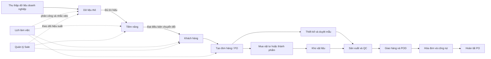

# Tổng quan phần mềm Sunflower ERP

> Tài liệu này mô tả mục tiêu, phạm vi, người dùng, các phân hệ và luồng nghiệp vụ của Sunflower ERP theo mã nguồn hiện tại. Nội dung dành cho quản lý, người sử dụng mới, đơn vị triển khai, kiểm thử viên và lập trình viên cần hiểu hệ thống trước khi thao tác hoặc phát triển tiếp.

## 1. Sunflower ERP là gì?

Sunflower ERP là hệ thống quản trị nội bộ dành cho doanh nghiệp kinh doanh và sản xuất tem nhãn. Phần mềm kết nối toàn bộ hành trình từ lúc Sale tìm thấy thông tin một doanh nghiệp trên Internet cho đến khi doanh nghiệp đó trở thành khách hàng, phát sinh đơn hàng, thiết kế mẫu, mua vật tư, sản xuất, giao hàng, xuất hóa đơn và thu công nợ.

Mục tiêu chính của hệ thống:

- Tập trung dữ liệu khách hàng và hoạt động kinh doanh vào một nơi.
- Giữ dữ liệu xuyên suốt khi chuyển từ **Dữ liệu thô → Tiềm năng → Khách hàng → Đơn hàng**.
- Giúp quản lý nhìn được tình hình chung, năng suất Sale, điểm nghẽn và việc cần xử lý.
- Kết nối Sale với Thiết kế, Mua hàng, Kho, Sản xuất, Giao hàng và Kế toán trên cùng một PO.
- Lưu lịch sử thao tác, cuộc gọi, lịch chăm sóc, phân công và thay đổi trạng thái.
- Hạn chế nhập lại dữ liệu và giảm thất thoát thông tin khi bàn giao giữa các bộ phận.

## 2. Bức tranh tổng thể



Ba nguyên tắc dữ liệu xuyên suốt:

1. **Kế thừa:** thông tin doanh nghiệp, nguồn, địa bàn, nhu cầu, người phụ trách và tệp liên quan được chuyển tiếp thay vì nhập lại.
2. **Truy vết:** hồ sơ sau chuyển đổi vẫn có liên kết về hồ sơ nguồn; lịch sử gọi và hoạt động được giữ theo hành trình.
3. **Phân quyền:** mỗi vai trò chỉ thấy các phân hệ được cấp; Admin có phạm vi quản lý rộng nhất.

## 3. Nhóm người dùng và quyền mặc định

| Vai trò | Trách nhiệm chính | Phân hệ mặc định |
|---|---|---|
| **Admin / Giám đốc** | Theo dõi toàn hệ thống, quản lý Sale, tài khoản, cấu hình và dữ liệu | Toàn bộ các phân hệ |
| **Sale** | Tìm dữ liệu, chăm sóc tiềm năng, quản lý khách hàng và tạo PO | Tổng quan, Chat, Công việc, Thương mại, Dữ liệu thô, Tiềm năng, Khách hàng, Tạo đơn hàng |
| **Thiết kế** | Tiếp nhận yêu cầu, thực hiện thiết kế và theo dõi khách duyệt | Tổng quan, Chat, Công việc, Thiết kế |
| **Mua hàng** | Xử lý yêu cầu mua, chọn nhà cung cấp và quản lý vật tư | Tổng quan, Chat, Công việc, Mua hàng, Nhà cung cấp, Vật liệu |
| **Sản xuất** | Nhận lệnh sản xuất, quản lý lịch máy và tiến độ | Tổng quan, Chat, Công việc, Sản xuất |
| **Kế toán** | Theo dõi hóa đơn, công nợ và lãi gộp | Tổng quan, Chat, Công việc, Kế toán |

Admin có thể thay đổi danh sách trang được phép truy cập của từng tài khoản. Một tài khoản bị vô hiệu hóa không thể tiếp tục sử dụng luồng công việc.

## 4. Các phân hệ chức năng

### 4.1. Tổng quan

Trang Tổng quan cung cấp góc nhìn khác nhau theo vai trò.

**Đối với Admin / Giám đốc:**

- Theo dõi tổng hồ sơ, Dữ liệu thô, Tiềm năng, Khách hàng, khách đang hợp tác, nhân sự, doanh thu và đơn đang xử lý.
- Xem cơ cấu doanh thu, công nợ và hàng đợi PO.
- Theo dõi tám nhóm thông tin khách hàng; bấm vào nhóm, loại khách hàng và mở đúng danh sách tại phân hệ sở hữu dữ liệu.
- Xem các nhóm công việc cần xử lý theo hạn và mức ưu tiên.
- Lọc số liệu theo tháng hoặc khoảng ngày.

**Đối với Sale:**

- Xem công việc hôm nay, lịch quá hạn, Tiềm năng mới, khách hàng đang chăm sóc và đơn hàng trong kỳ.
- Theo dõi công việc ưu tiên, phễu khách hàng và các hoạt động cần tiếp tục.
- Đi nhanh đến Lịch làm việc, Tiềm năng hoặc Tạo đơn hàng.

### 4.2. Kênh chat

- Trao đổi nội bộ theo kênh và vai trò.
- Hỗ trợ gửi nội dung và tệp đính kèm.
- Các kênh có thể giới hạn người xem theo bộ phận, ví dụ kênh Kế toán.
- Chat bổ trợ giao tiếp; dữ liệu nghiệp vụ chính vẫn được ghi vào đúng hồ sơ và phân hệ.

### 4.3. Lịch làm việc / Công việc

Phân hệ có hai góc nhìn: **Công việc** và **Lịch tuần**.

Chức năng chính:

- Sếp giao việc cho nhân sự; nhân sự tự tạo việc hoặc giao/đề nghị hỗ trợ theo quyền.
- Liên kết công việc với Dữ liệu thô, Tiềm năng, Khách hàng, PO, yêu cầu thiết kế, lệnh sản xuất hoặc giao hàng.
- Ghi tên việc, nội dung, người giao, người thực hiện, bộ phận, hạn xử lý, loại việc và mức ưu tiên.
- Theo dõi trạng thái chưa bắt đầu, đang xử lý, chờ khách hàng, yêu cầu hỗ trợ, chờ xác nhận, không xử lý được và hoàn thành.
- Khi chọn “Không xử lý được”, người thực hiện phải ghi rõ nguyên nhân để quản lý nắm được trở ngại.
- Lịch tuần trình bày công việc theo thời gian để theo dõi tải công việc.

Các nhóm luồng công việc mặc định:

- Sếp giao cho nhân sự.
- Nhân sự giao việc lại cho công ty.
- Nhân sự giao cho nhân sự khác.
- Việc tự tạo cho chính mình.
- Việc tự động phát sinh từ hệ thống.

### 4.4. Quản lý Sale

Đây là phân hệ dành riêng cho Admin, dùng để trả lời bốn câu hỏi quản trị:

1. Sale có đang làm việc hay không?
2. Sale tìm được bao nhiêu Dữ liệu thô và chuyển đổi được bao nhiêu Tiềm năng/Khách hàng?
3. Sale đã thao tác gì trong các phân hệ kinh doanh?
4. Vì sao một cơ hội được chăm sóc lâu nhưng chưa chốt?

Các khả năng chính:

- Phân loại trạng thái hoạt động thành đang thao tác, tạm rảnh hoặc ngoại tuyến dựa trên hiện diện và hoạt động nghiệp vụ gần nhất.
- Xem phễu hiệu suất cá nhân và toàn đội.
- Thống kê hồ sơ tự tìm, hồ sơ được giao, hồ sơ đã xử lý, số cuộc gọi, lịch hẹn, lịch quá hạn và chuyển đổi.
- Lọc báo cáo theo tuần, tháng, quý hoặc khoảng ngày.
- Xem nhật ký thao tác theo Dữ liệu thô, Tiềm năng và Khách hàng.
- Xem các cơ hội chưa chốt, số ngày chăm sóc và nguyên nhân đang cản trở.

### 4.5. Thương mại

- Tổng hợp dữ liệu thị trường theo tỉnh/thành.
- Có hai chế độ **Tỉnh thành** và **Bản đồ**.
- Thể hiện số lượng hồ sơ, trạng thái và mức tiềm năng theo địa bàn.
- Cho phép mở nhóm hồ sơ tại khu vực cần quan tâm để tiếp tục khai thác.

### 4.6. Dữ liệu thô

Dữ liệu thô là nơi lưu các doanh nghiệp mới được Sale tìm thấy từ Internet, Google Maps, Facebook, hội chợ, giới thiệu hoặc nguồn khác. Ở giai đoạn này doanh nghiệp có thể chưa có người liên hệ và chưa được xác nhận là cơ hội bán hàng.

Thông tin chính:

- Nhận diện doanh nghiệp: tên, mã số thuế, website, lĩnh vực, địa chỉ, tỉnh/thành, phường/xã và khu công nghiệp.
- Nguồn dữ liệu: nguồn tìm kiếm, đường dẫn nguồn và người tìm được dữ liệu.
- Thông tin liên hệ nếu đã có: người liên hệ, chức vụ, điện thoại và email.
- Nhu cầu sơ bộ, ghi chú, tệp liên quan, người phụ trách và lịch liên hệ tiếp theo.
- Trạng thái liên hệ, mức tiềm năng, lịch sử thao tác và lịch sử cuộc gọi.

**Trang Tổng quan Dữ liệu thô:**

- Tổng số dữ liệu, dữ liệu mới, đã gọi, chưa gọi, đã liên hệ được và đã chuyển Tiềm năng.
- Xu hướng dữ liệu mới và hồ sơ đã gọi theo thời gian.
- Số dữ liệu Sale tự tìm và cơ cấu nguồn dữ liệu.
- Chấm điểm ưu tiên để chia thành **Nên gọi trước**, **Cần bổ sung thông tin** và **Chưa nên gọi**.
- Bảng ưu tiên hiển thị điểm và lý do xếp nhóm; Admin có thể cấu hình tiêu chí chấm điểm.

**Thao tác nghiệp vụ:**

- Tìm kiếm, lọc nâng cao, sắp xếp, tùy chỉnh cột và phân trang.
- Gọi điện, ghi nhận kết quả, xem lịch sử, hẹn lịch, giao việc và bàn giao Sale.
- Ghim, đưa vào hàng xử lý, hoàn tất công việc, lưu trữ hoặc chuyển thành Tiềm năng.
- Phát hiện trùng theo mã số thuế, điện thoại hoặc tên doanh nghiệp.

### 4.7. Tiềm năng

Tiềm năng là hồ sơ đã có đủ tín hiệu để Sale chăm sóc sâu hơn nhưng chưa trở thành khách hàng chính thức.

Chức năng chính:

- Trang Tổng quan thể hiện tình hình chung, cơ hội, theo dõi Sale và phân bổ theo tỉnh thành.
- Quản lý hồ sơ doanh nghiệp, địa bàn, người liên hệ, nhu cầu, giá trị tiềm năng và Sale phụ trách.
- Quản lý giai đoạn xử lý, xác suất chốt, mục tiêu tiếp theo, kết quả liên hệ và lịch chăm sóc.
- Lưu hoạt động, ghi chú, tệp thiết kế/báo giá/tài liệu và thư mục liên quan.
- Phân loại khách hàng theo các nhóm thông tin dùng chung của Dashboard.
- Gọi điện, ghi nhận cuộc gọi, giao việc, yêu cầu hỗ trợ và xem lịch sử.
- Chuyển thành Khách hàng khi đạt điều kiện; có thể chuyển ngược về Dữ liệu thô nếu hồ sơ chưa phù hợp.

### 4.8. Khách hàng

Khách hàng là hồ sơ doanh nghiệp chính thức sau chuyển đổi, dùng làm nguồn dữ liệu cho đơn hàng và các bộ phận phía sau.

Chức năng chính:

- Trang Tổng quan theo dõi khách hàng theo địa bàn, hoạt động mua hàng và các chỉ số liên quan.
- Quản lý hồ sơ doanh nghiệp, mã khách hàng, hạng khách hàng, mã số thuế và Sale phụ trách.
- Quản lý địa bàn và địa chỉ giao hàng.
- Quản lý nhiều đầu mối liên hệ, số điện thoại mua hàng, kho và email.
- Quản lý sản phẩm đã quan tâm/đặt hàng, nhu cầu kế thừa, lịch sử vật liệu và mẫu.
- Quản lý điều khoản thương mại: loại chiết khấu, tỷ lệ/số tiền chiết khấu, hạn mức công nợ, điều khoản thanh toán và tài khoản ngân hàng.
- Kho lưu trữ hồ sơ gồm thư mục, hợp đồng, báo giá, biên bản, tài liệu kỹ thuật và tệp khác.
- Lưu ghi chú, lịch sử giao dịch, PO và các phiên bản thông tin quan trọng.
- Chuẩn bị dữ liệu đơn hàng trước khi chuyển sang Tạo đơn hàng.

### 4.9. Tạo đơn hàng / Sale PO

Phân hệ này quản lý khách hàng chờ lên đơn và các khách hàng đã có PO.

Chức năng chính:

- Tạo PO từ hồ sơ khách hàng, kế thừa thông tin liên hệ và điều khoản thương mại.
- Nhập nhiều mặt hàng, mã hàng, quy cách, vật liệu, kích thước, số lượng, đơn giá, ngày giao và yêu cầu kỹ thuật.
- Đính kèm hình ảnh, layout cũ, file AI/Corel và tài liệu liên quan.
- Tính tổng tiền, chiết khấu và giá trị ròng.
- Lưu ảnh chụp thông tin khách hàng tại thời điểm tạo đơn để bảo toàn lịch sử.
- Phân công chi tiết cho Thiết kế, Mua hàng, Sản xuất và các bộ phận liên quan.
- Theo dõi lịch sử cập nhật và hàng đợi PO.

Các trạng thái hàng đợi chuẩn:

1. Chờ thiết kế.
2. Chờ sản xuất.
3. Chờ giao.
4. Chờ xuất hóa đơn.
5. Chờ thu công nợ.
6. Chờ xử lý chiết khấu.
7. Hoàn tất.

### 4.10. Thiết kế

- Tự động hình thành yêu cầu thiết kế từ từng mặt hàng trong PO cần thiết kế.
- Theo dõi mã yêu cầu, PO, khách hàng, mặt hàng, brief, hình tham chiếu, người phụ trách và hạn hoàn thành.
- Trạng thái công việc: chưa kiểm tra, chưa xử lý, đang xử lý, chờ thêm thông tin và đã hoàn thành.
- Trạng thái khách duyệt: chưa gửi khách, chờ khách duyệt, khách yêu cầu sửa và khách đã duyệt mẫu.
- Quản lý nhiều phiên bản thiết kế, ảnh xem trước, liên kết AI/Corel, phản hồi của khách và lịch sử cập nhật.
- Hỗ trợ tái sử dụng thiết kế cũ khi có nguồn phù hợp.

### 4.11. Kho mẫu

- Lưu các mẫu thiết kế đã hoàn thành/được duyệt để tra cứu lại.
- Tìm mẫu theo PO, khách hàng hoặc thông tin mặt hàng.
- Mở lại ảnh, tệp thiết kế và phiên bản liên quan phục vụ tái sử dụng.

### 4.12. Mua hàng

Phân hệ có hai danh sách: **Yêu cầu từ Sale PO** và **Đơn mua đã phát hành**.

- Sinh yêu cầu mua theo mặt hàng của PO.
- Phân biệt mua thành phẩm, mua nguyên vật liệu và thuê nhà cung cấp gia công.
- Theo dõi từ mới nhận, phân tích, lấy báo giá, chọn nhà cung cấp, đặt hàng, nhận một phần đến nhận đủ hoặc hủy.
- Phân công nhân viên Mua hàng và ghi nhận giá được chọn.
- Gợi ý nhà cung cấp dựa trên lịch sử mặt hàng tương tự, giá, tỷ lệ giao đúng hạn, số đơn đã mua, độ gần đây và đánh giá nhà cung cấp.
- Tạo đơn mua và liên kết ngược về PO/khách hàng/mặt hàng nguồn.

### 4.13. Nhà cung cấp

- Quản lý mã nhà cung cấp, pháp lý, địa bàn, liên hệ, nhóm hàng/dịch vụ và người Mua hàng phụ trách.
- Lưu điều khoản thanh toán, ngân hàng, trạng thái, đánh giá và ghi chú.
- Quản lý nhiều đầu mối liên hệ, tài liệu, hợp đồng và nhật ký hoạt động.
- Xem lịch sử cung ứng để hỗ trợ lựa chọn nhà cung cấp.

### 4.14. Vật liệu / Kho nguyên vật tư

Phân hệ có ba góc nhìn:

- **Tồn kho hiện tại:** số lượng khả dụng, đơn vị, vị trí và thông tin vật liệu.
- **Lịch sử phiếu xuất kho:** theo dõi vật tư đã xuất cho sản xuất.
- **Báo cáo nhập – xuất – tồn:** tổng hợp biến động vật liệu trong kỳ.

Kho nhận liên kết từ Mua hàng và cấp vật tư cho lệnh sản xuất.

### 4.15. Sản xuất

- Quản lý danh sách lệnh sản xuất (LSX).
- Theo dõi tiến độ sản xuất theo PO và mặt hàng.
- Quản lý lịch máy và danh mục máy.
- Khai báo trạng thái máy: sẵn sàng, đang chạy, bảo trì, lỗi hoặc ngừng hoạt động.
- Gán máy/người vận hành, ghi nhận sản lượng, vật liệu, thời gian và trạng thái thực hiện.
- Hỗ trợ góc nhìn dành cho người vận hành máy và luồng kiểm tra chất lượng trước khi giao.

### 4.16. Giao hàng

Phân hệ gồm bốn khu vực:

- **Bảng điều phối:** gom nhu cầu giao và chuẩn bị chuyến.
- **Chuyến giao:** tạo lộ trình, thứ tự điểm giao, tài xế, xe và ngày giao.
- **Xe & tài xế:** quản lý phương tiện và nhân sự giao hàng.
- **POD & đối soát:** lưu bằng chứng giao hàng, chữ ký, số lượng thực giao, giao một phần và kết quả đối soát.

Hệ thống phân biệt luồng nhà cung cấp giao vật tư tới và luồng giao thành phẩm cho khách hàng.

### 4.17. Kế toán

Phân hệ có hai khu vực:

- **Công nợ phải thu & phải trả:** quản lý hóa đơn, số tiền, hạn thanh toán, tình trạng thu/chi và người phụ trách.
- **Báo cáo lãi gộp đơn hàng:** tổng hợp doanh thu, chi phí và kết quả theo PO.

Kế toán tiếp nhận PO sau giao hàng để xuất hóa đơn, thu công nợ và hoàn thiện phần tài chính của đơn.

### 4.18. Tài khoản, cấu hình và thùng rác

**Tài khoản:**

- Tạo và quản lý người dùng Firebase.
- Gán vai trò, bật/tắt tài khoản và cấp quyền trang.

**Cấu hình:**

- Thêm trường thông tin tùy chỉnh cho Dữ liệu thô, Tiềm năng và Khách hàng.
- Điều chỉnh trường hệ thống trong phạm vi được cho phép.
- Cấu hình tiêu chí lọc và cách hiển thị dữ liệu.
- Admin có thể quản lý bố cục cột dùng chung; người dùng sử dụng bố cục phù hợp với quyền của mình.

**Thùng rác:**

- Tập trung các bản ghi đã xóa mềm như khách hàng, tiềm năng, nhà cung cấp và hóa đơn.
- Cho phép khôi phục hoặc xử lý theo quyền quản trị.

## 5. Hệ thống phân loại khách hàng dùng chung

Dashboard và các phân hệ kinh doanh dùng một danh mục chung gồm **8 nhóm và 61 mục hiện có**. Mỗi mục có một phân hệ sở hữu rõ ràng; khi bấm từ Dashboard, hệ thống mở danh sách tại đúng phân hệ đó.

| Nhóm | Số mục | Phân hệ lưu chính | Nội dung tiêu biểu |
|---|---:|---|---|
| Tiến độ mẫu / đơn hàng / PO | 8 | Tiềm năng | Hẹn lên PO, duyệt mẫu, test mẫu, gửi mẫu, cung cấp thông tin sản phẩm |
| Giá / điều kiện thương mại | 5 | Tiềm năng | Giá target, hứa giá target, giá thấp/cao, khảo giá |
| Liên hệ / tương tác | 14 | Dữ liệu thô và Tiềm năng | Chưa có thông tin, contact mua hàng, Gmail/Zalo, hẹn gặp, làm việc từ xa, Sale đã báo giá |
| Quy mô / mức sử dụng | 6 | Tiềm năng | Dùng ít đến trên 100 triệu |
| Quan hệ NCC / cạnh tranh | 6 | Tiềm năng | Bị chỉ định, không đổi NCC, đã dùng sản phẩm, Sale khác chăm sóc |
| Yêu cầu / điều kiện đặc biệt | 7 | Tiềm năng | Chứng chỉ, tiến độ, chất lượng, khoảng cách, audit nhà xưởng |
| Sản phẩm / nhu cầu | 4 | Tiềm năng | Máy móc, tem nhãn, mực in, file thiết kế |
| Ngành nghề khách hàng | 11 | Dữ liệu thô | May mặc, điện tử, F&B, bao bì, y tế, logistics, dược/mỹ phẩm, nông nghiệp, gia dụng/kim khí, ô tô/xe máy, hóa chất/sơn |

Danh mục này giúp lãnh đạo trả lời câu hỏi “nhóm khách nào đang ở đâu” mà không trộn dữ liệu giữa các giai đoạn.

## 6. Dữ liệu được kế thừa như thế nào?

### 6.1. Dữ liệu thô → Tiềm năng

Được kế thừa:

- Tên doanh nghiệp, mã số thuế, website, lĩnh vực và địa bàn.
- Người liên hệ, điện thoại, email nếu đã thu thập.
- Nguồn dữ liệu và Sale tìm được.
- Nhu cầu sơ bộ, ghi chú, tệp liên quan và phân loại đã có.
- Sale phụ trách và liên kết về hồ sơ Dữ liệu thô.

Được bổ sung ở Tiềm năng:

- Giai đoạn bán hàng, giá trị tiềm năng, xác suất chốt và ngày dự kiến chốt.
- Kết quả làm việc, mục tiêu tiếp theo và lịch chăm sóc.
- Các phân loại sâu về mẫu, giá, tương tác, cạnh tranh và yêu cầu đặc biệt.

### 6.2. Tiềm năng → Khách hàng

Được kế thừa:

- Toàn bộ nhận diện doanh nghiệp, địa bàn, liên hệ, nguồn, nhu cầu và tệp.
- Sale phụ trách, người tìm được Lead và liên kết về hồ sơ Tiềm năng.
- Phân loại khách hàng đã ghi nhận.

Được bổ sung ở Khách hàng:

- Mã và hạng khách hàng.
- Liên hệ mua hàng/kho, địa chỉ giao nhận.
- Danh mục sản phẩm, hợp đồng và kho tài liệu.
- Chiết khấu, hạn mức công nợ, thanh toán và ngân hàng.

### 6.3. Khách hàng → PO và các bộ phận vận hành

- PO lấy thông tin khách hàng và điều khoản thương mại tại thời điểm tạo đơn.
- Mỗi mặt hàng có thể tạo yêu cầu Thiết kế, Mua hàng và Sản xuất riêng.
- Trạng thái PO phản ánh điểm đang chờ của toàn bộ quy trình.
- Giao hàng, hóa đơn và công nợ cập nhật tiếp vào hành trình của PO.

## 7. Chức năng dùng chung trên nhiều phân hệ

- Tìm kiếm và bộ lọc nâng cao.
- Phân trang, sắp xếp, kéo đổi thứ tự và thay đổi độ rộng cột.
- Cấu hình cột hiển thị và trường thông tin.
- Menu thao tác theo từng dòng.
- Số điện thoại có menu Gọi, Ghi nhận và Lịch sử.
- Phân công công việc hoặc yêu cầu quản lý hỗ trợ ngay từ hồ sơ.
- Ghi nhận lịch sử thay đổi và người thực hiện.
- Thông báo theo phân hệ.
- Xóa mềm và khôi phục qua Thùng rác đối với dữ liệu được hỗ trợ.
- Giao diện tiếng Việt, có cơ chế ngôn ngữ dùng chung và sử dụng phông Inter.

## 8. Kiến trúc kỹ thuật

### 8.1. Công nghệ

- Giao diện: React, TypeScript và Vite.
- Dữ liệu và xác thực: Firebase Authentication, Firestore và Storage theo cấu hình môi trường.
- Chế độ dự phòng: local storage khi Firebase runtime không khả dụng trong một số luồng phát triển.
- Triển khai: có cấu hình Firebase và Vercel; bản production được tạo trong thư mục `dist`.

### 8.2. Tổ chức mã nguồn

```text
src/
├── app/             # Khung ứng dụng, điều hướng, phân quyền và vòng đời
├── features/        # Các phân hệ nghiệp vụ
├── components/      # Thành phần giao diện dùng chung
├── shared/          # Kiểu dữ liệu và tiện ích dùng chung
├── infrastructure/  # Firebase và local-storage adapters
├── services/        # Audit, thông báo, cấu hình và bố cục bảng
├── domain/          # Quy tắc tài chính, PO và cấu hình hệ thống
└── data/            # Seed và dữ liệu danh mục tĩnh
```

Mỗi phân hệ thường tách thành `pages`, `components`, `model` và `api`. Quy tắc nghiệp vụ nằm trong model/service; giao diện không nên tự thay đổi hợp đồng dữ liệu hoặc quyền truy cập.

### 8.3. An toàn dữ liệu và kiểm soát thay đổi

- Firestore Rules kiểm soát quyền đọc/ghi theo vai trò và trạng thái tài khoản.
- Mã số thuế được kiểm tra để hạn chế trùng giữa Dữ liệu thô, Tiềm năng và Khách hàng.
- Các trường hệ thống quan trọng được bảo vệ; cấu hình trường không được âm thầm xóa dữ liệu lịch sử.
- Hoạt động quan trọng được ghi audit để phục vụ báo cáo Sale và truy vết.
- Hồ sơ nghiệp vụ dùng xóa mềm ở các khu vực cần khôi phục.

## 9. Thuật ngữ chính

| Thuật ngữ | Ý nghĩa |
|---|---|
| **Dữ liệu thô** | Thông tin doanh nghiệp mới thu thập, chưa đủ xác nhận là cơ hội |
| **Tiềm năng / Lead** | Doanh nghiệp đã có tín hiệu và đang được Sale chăm sóc |
| **Khách hàng** | Hồ sơ chính thức đủ điều kiện giao dịch và tạo đơn |
| **PO** | Đơn hàng Sale, là trục liên kết các bộ phận phía sau |
| **LSX** | Lệnh sản xuất |
| **NCC** | Nhà cung cấp |
| **POD** | Bằng chứng giao hàng/đối soát giao nhận |
| **Hàng đợi PO** | Trạng thái cho biết PO đang chờ bộ phận hoặc bước nào |
| **Phân loại khách hàng** | Danh mục 8 nhóm dùng để phân tích và điều hướng hồ sơ |
| **Audit** | Nhật ký hành động của người dùng trên dữ liệu nghiệp vụ |

## 10. Phạm vi của tài liệu

- Tài liệu mô tả chức năng đang thể hiện trong mã nguồn tại thời điểm cập nhật.
- Quyền thực tế có thể khác quyền mặc định nếu Admin đã cấu hình riêng cho tài khoản.
- Một số màn hình hoặc chỉ số chỉ xuất hiện khi có dữ liệu phù hợp.
- Tài liệu không thay thế hướng dẫn thao tác từng bước, tài liệu triển khai Firebase hoặc quy tắc dành cho lập trình viên.

Các tài liệu kỹ thuật liên quan:

- `README.md`: cài đặt, chạy và triển khai cơ bản.
- `docs/ARCHITECTURE.md`: kiến trúc và hướng phụ thuộc mã nguồn.
- `docs/DEVELOPER_GUIDELINES.md`: tiêu chuẩn phát triển và giao diện.
- `docs/FIELD_CONFIGURATION.md`: cơ chế cấu hình trường và bảo vệ dữ liệu.

---

**Tên sản phẩm:** Sunflower ERP  
**Loại hệ thống:** ERP nội bộ cho kinh doanh và sản xuất tem nhãn  
**Phạm vi xuyên suốt:** CRM → PO → Thiết kế/Mua hàng/Kho → Sản xuất → Giao hàng → Kế toán
