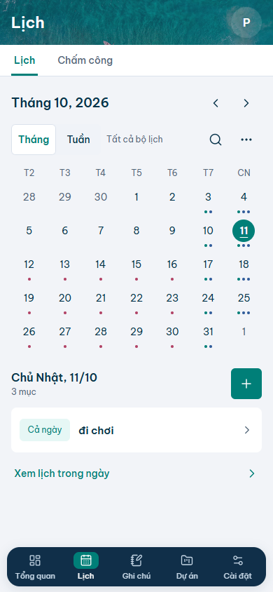
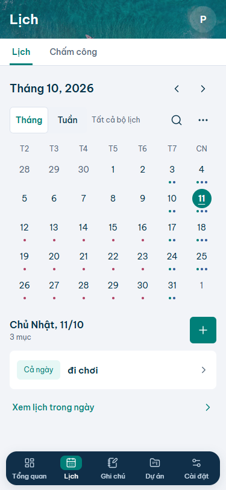
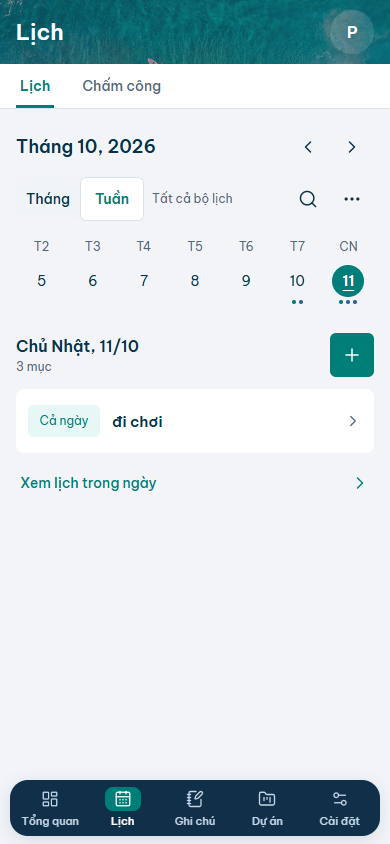
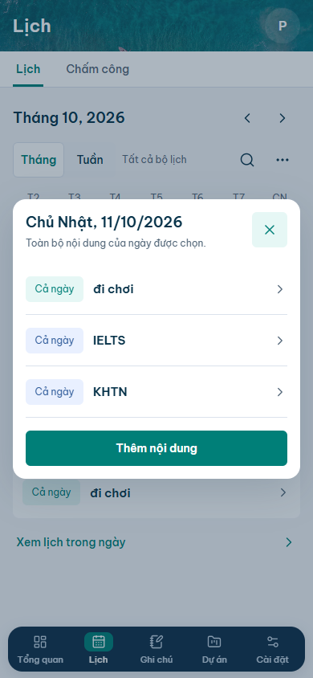
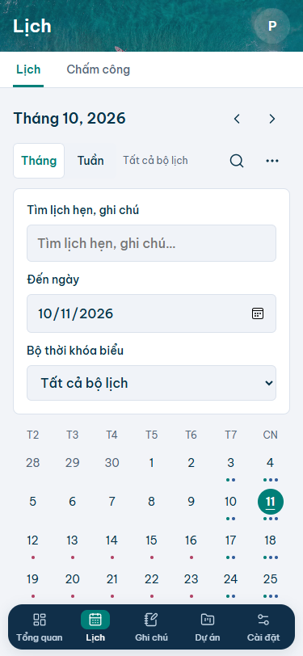

# MyOS — Bản thiết kế mobile v2 để duyệt

**Ảnh đã được cập nhật sang bản xem thử v3:** ảnh biển thật / nav56 / dialog giữa màn hình. [Chi tiết cập nhật](mobile-design-update.md). Các số đo v2 và nhận xét lịch sử bên dưới chỉ mô tả bản trước.

Bổ sung theo yêu cầu mới: [bộ thiết kế các phân hệ còn lại](mobile-suite-review.md), [spec mở rộng](mobile-suite-spec.md). Chỉ mở rộng bản thiết kế, chưa code các màn còn lại.

11/10/2026 · Workflow: **audit hoàn thành → rules + thiết kế đích hoàn thành để review → chờ duyệt → implementation một màn → QA app thật**.

Đây là bản mới dựng từ bộ quy tắc sau audit. **Chưa triển khai vào MyOS**, không phải screenshot runtime của ứng dụng. Bản thử trước vẫn là lịch sử kiểm tra kỹ thuật tại [design-review](design-review.md), chưa được duyệt. Bộ v2 thay các đề xuất trước, không tuyên bố đã pixel-match các mẫu raster.

## Xem bản thiết kế

Mở [preview độc lập](mobile-design/calendar-preview.html): xem tháng/tuần, mở filter, chọn ngày11 hoặc Xem lịch trong ngày để xem sheet. Các thao tác ngoài preview có thông báo giới hạn; không lưu dữ liệu. Font và Lucide được nhúng từ package hiện có; không gọi nguồn ngoài.

### Tháng — 390 ×844

### Tháng — 375 ×812

### Tuần — 390 ×844

### Sheet ngày — 390 ×844

### Filter mở — 375 ×812

Filter làm trang dài và cuộn theo flow; [ảnh toàn nội dung](mobile-design/calendar-filters-full-375.png) giúp thấy preview phía dưới. Fixed nav trong ảnh full-page vẫn ở vị trí viewport lúc chụp, không phải component nằm giữa layout flow.

## So với ảnh cũ và bản thử trước

[Ảnh Lịch cũ người dùng](mobile-ui-audit/original-calendar.png) có chrome Safari; không dùng toàn chiều cao đó để so pixel CSS. [Bản thử runtime390](mobile-ui-audit/calendar-pilot-390.png) cùng viewport dùng để so geometry với preview mới; dữ liệu event khác nên không so chiều dài text tuyệt đối.

| Vùng | Cũ / bản thử | Đích v2 | Căn cứ |
| --- | --- | --- | --- |
| Header | Cũ gradient72/title25; bản thử navy64/title 22 riêng tab | Navy64/title 22 theo rule chung | A05, toolbar gọn R1, màu giữ MyOS; P cần duyệt |
| Controls | Cũ ghép month/arrows/view; bản thử view fullrow rồi filterrow | Month+arrows một hàng; view/scope/search/menu chung hàng 44 | Giảm phân mảnh toolbar mà giữ toàn controls |
| Grid | Cũ viền ô; bản thử no border, row52, selected softwholecell | No border, row 48, selectedcircle 32, todayunderline | Nhịp R1/R2B; today khác selected |
| Preview position390 | Bản thử bắt đầu y633 | v2 y525, sớm108px | Đ-preview; không dùng browser chrome cũ làm baseline tọa độ |
| Nội dung ngày | Cardpreview lồng, event nền màu | Section mở cùng trục16; event trắng, time màu nhóm | D01/D06/D13; giữ firstevent + link + sheetall |
| Nav | Cũ70/label11, pilot72/12 riêng route | Chuẩn72/label12/5 nhãn, no translate, reserve chung | A10; R3B chỉ tham khảo pattern |
| Sheet | Quy tắc padding/action chưa toàn app nhất quán | Gutter16/title 18/close 44/action 44 | D10/D11; giữ allentries và add |

Không thay schema, data, autosave, timezone, luồng tạo/chỉnh sửa, lọc/xuất, số module. Không thêm ảnh/card/chart. Nội dung sample đi chơi/IELTS/KHTN và tháng10/2026 lấy từ screenshot cũ chỉ để dễ đối chiếu; màu marks là minh họa nhóm, không tuyên bố tái tạo màu userdata chính xác.

## Kiểm tra bản thiết kế độc lập

Render Chromium/Edge: 4 trạng thái ×3 viewport390 × 844/375 × 812/320 × 740 =12 ảnh viewport; thêm3 ảnh filterfullpage. Không overflow ngang, font đã load, không JavaScript error. [Số đo](mobile-design/verification.json). Đã xem ảnh tháng390 và sheet375 để kiểm tra glyph/alignment/chữ tiếng Việt, đồng thời kiểm tra responsive ở375/320. Safe areas trong môi trường này0.

Đã thử chuyển tháng/tuần, mở/đóng filter và sheet, vòng focus trong sheet và Escape. Preview không ghi dữ liệu ứng dụng. Có thể xem trực tiếp tại [preview local](http://127.0.0.1:3111/) khi server review đang chạy; chạy lại bằng node docs/mobile-design/serve-preview.cjs nếu cần.

Đây là kiểm tra artifact thiết kế, **không phải Bước 3 chạy MyOS mới**. Chưa kiểm tra auth/cloud/runtime app sau implementation, bàn phím Safari trên thiết bị thật, safe-area thiết bị hay zoom 200%; không chạy build/lint giả cho tài liệu. Sau duyệt cần nối layout vào component thật và làm QA luồng ứng dụng.

## Các điểm duyệt và giới hạn

1. Header/nav theo bộ chuẩn chung: navy đặc, title 22, nhãn nav12; các route còn lại chưa rollout.
2. Options compact128 và scope/search/menu cùng hàng, grid row 48/selectedcircle 32.
3. Preview mở + time màu thay nền event phủ toàn hàng; giữ số lượng preview một mục.
4. Sheet ngày và bộ quy tắc sizing/type/spacing/state.

Không cần ảnh mới để dựng Lịch. Favicon còn thiếu từ audit, không tự tạo. Chưa có ảnh đích loading/error/empty/formcreate; cần bổ sung ở lượt implementation bằng dữ liệu/state thật theo rule đã nêu, không giả vờ đã được visual review.

Sau khi người dùng duyệt, code **chỉ màn Lịch**, chụp app thật390 × 844 và375 × 812 so với v2, kiểm tra hành vi/runtime, báo file thay đổi và sai lệch. Dừng trước khi làm các màn còn lại.

## Tài liệu bàn giao

[Quy tắc](design-rules.md) · [Phân tích tham khảo](design-reference.md) · [Spec](design-spec.md) · [Tokens](design-tokens.md) · [Components](component-map.md).

Build lại artifact bằng node docs/mobile-design/build-preview.cjs và node docs/mobile-design/render-preview.cjs tại root repo. Hai script phục vụ tái tạo bản review, không là dependency hoặc feature production.
