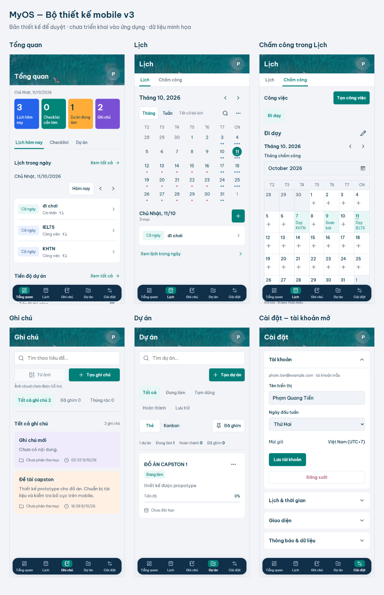

# MyOS — Bộ thiết kế mobile mở rộng để duyệt

**Ảnh đã được cập nhật sang bản xem thử v3:** ảnh biển thật / nav56 / dialog giữa màn hình. [Chi tiết cập nhật](mobile-design-update.md). Các số đo v2 và nhận xét lịch sử bên dưới chỉ mô tả bản trước.

11/10/2026 · **Bản mới dựng theo rules v2; chưa triển khai vào MyOS.** Đáp ứng yêu cầu tạo bản thiết kế cho các phân hệ còn lại. Lịch v2 trước vẫn giữ riêng, thêm Tổng quan/Ghi chú/Dự án/Cài đặt và tab Chấm công. Không thay code ứng dụng trong lượt này.

## Xem toàn bộ

[Gallery trực tiếp](http://127.0.0.1:3111/index.html) · [Gallery lưu tại repo](mobile-design/index.html) · [Đặc tả từng phân hệ](mobile-suite-spec.md) · [Rules](design-rules.md) · [Tokens](design-tokens.md).

Gallery cho mở từng màn và chuyển route bằng5 mục nav. Có17 trang trạng thái chính/phụ và4 biến thể form/nháp =21 trạng thái mới. Nội dung ngày, ghi chú, dự án, tài khoản và save state đều là mẫu, không phải dữ liệu thật. HTML/CSS được dựng từ rules/source, font Be Vietnam Pro và icon Lucide; không dùng ảnh AI hoặc screenshot làm background UI.

Board chỉ là ảnh tổng hợp viewport, các màn dài phải cuộn. Không ép toàn bộ nội dung vào844px, không bỏ hàng grid/dữ liệu dưới navigation. Ảnh đầy đủ có trong album bên dưới.

## Album từng trạng thái

| Màn hình / trạng thái | 390 ×844 | 375 ×812 |
| --- | --- | --- |
| Tổng quan — Lịch hôm nay | [Ảnh](mobile-design/overview-390x844.png) | [Ảnh](mobile-design/overview-375x812.png) |
| Tổng quan — Checklist | [Ảnh](mobile-design/overview-checklist-390x844.png) | [Ảnh](mobile-design/overview-checklist-375x812.png) |
| Tổng quan — Dự án | [Ảnh](mobile-design/overview-projects-390x844.png) | [Ảnh](mobile-design/overview-projects-375x812.png) |
| Ghi chú — Thư viện | [Ảnh](mobile-design/notes-390x844.png) | [Ảnh](mobile-design/notes-375x812.png) |
| Ghi chú — Thư mục & nhãn | [Ảnh](mobile-design/notes-organized-390x844.png) | [Ảnh](mobile-design/notes-organized-375x812.png) |
| Ghi chú — Editor | [Ảnh](mobile-design/note-editor-390x844.png) | [Ảnh](mobile-design/note-editor-375x812.png) |
| Ghi chú — Lịch sử rỗng | [Ảnh](mobile-design/note-history-390x844.png) | [Ảnh](mobile-design/note-history-375x812.png) |
| Dự án — Thẻ | [Ảnh](mobile-design/projects-390x844.png) | [Ảnh](mobile-design/projects-375x812.png) |
| Dự án — Kanban | [Ảnh](mobile-design/projects-kanban-390x844.png) | [Ảnh](mobile-design/projects-kanban-375x812.png) |
| Dự án — Chi tiết | [Ảnh](mobile-design/project-detail-390x844.png) | [Ảnh](mobile-design/project-detail-375x812.png) |
| Dự án — Tạo | [Ảnh](mobile-design/project-create-390x844.png) | [Ảnh](mobile-design/project-create-375x812.png) |
| Dự án — Sửa | [Ảnh](mobile-design/project-edit-390x844.png) | [Ảnh](mobile-design/project-edit-375x812.png) |
| Cài đặt — Đóng | [Ảnh](mobile-design/settings-390x844.png) | [Ảnh](mobile-design/settings-375x812.png) |
| Cài đặt — Tài khoản mở | [Ảnh](mobile-design/settings-account-390x844.png) | [Ảnh](mobile-design/settings-account-375x812.png) |
| Cài đặt — Lịch & thời gian mở | [Ảnh](mobile-design/settings-calendar-390x844.png) | [Ảnh](mobile-design/settings-calendar-375x812.png) |
| Chấm công — Bảng tháng | [Ảnh](mobile-design/attendance-390x844.png) | [Ảnh](mobile-design/attendance-375x812.png) |
| Chấm công — Nhập ngày | [Ảnh](mobile-design/attendance-day-390x844.png) | [Ảnh](mobile-design/attendance-day-375x812.png) |
| Chấm công — Ngày trống | [Ảnh](mobile-design/attendance-empty-day-390x844.png) | [Ảnh](mobile-design/attendance-empty-day-375x812.png) |
| Chấm công — Xung đột | [Ảnh](mobile-design/attendance-conflict-390x844.png) | [Ảnh](mobile-design/attendance-conflict-375x812.png) |
| Chấm công — Tạo công việc | [Ảnh](mobile-design/attendance-activity-390x844.png) | [Ảnh](mobile-design/attendance-activity-375x812.png) |
| Chấm công — Sửa/xóa công việc | [Ảnh](mobile-design/attendance-edit-390x844.png) | [Ảnh](mobile-design/attendance-edit-375x812.png) |

Ảnh toàn nội dung: [Tổng quan](mobile-design/overview-full-390.png), [Ghi chú](mobile-design/notes-full-390.png), [Editor](mobile-design/note-editor-full-390.png), [Dự án](mobile-design/projects-full-390.png), [Kanban](mobile-design/projects-kanban-full-390.png), [Chi tiết](mobile-design/project-detail-full-390.png), [Cài đặt mở](mobile-design/settings-calendar-full-390.png), [Chấm công](mobile-design/attendance-full-390.png). Fixed nav trong full-page ở vị trí viewport lúc chụp, không là component giữa flow.

Form sau khi cuộn tới cuối: [Tạo375](mobile-design/project-create-bottom-375.png), [Sửa375](mobile-design/project-edit-bottom-375.png). Field tiến độ cuối có thể đưa lên trước footer; không thấy field trong ảnh đầu không đồng nghĩa đã bỏ field.

## Khác biệt có căn cứ với giao diện cũ

| Phần | Hiện trạng audit | Bản đích đề xuất |
| --- | --- | --- |
| Shell | Header72/title 25, nhiều trục12/14/20, navlabel11 | Header64/title 22, main16, nav 72/label 12; một contract dùng chung |
| Tổng quan | Gradient lớn, KPI đầu to hơn/cột rộng hơn | Title trong header; dải4 số ngang đều, bốn màu KPI hiện có; giữ3 tabs/featuredproject/note |
| Ghi chú | Card220 và excerpt min65 | Không min-height; tại390 fixtureempty121 và đoạntext144, thay vì220. Title/metadata theo flow |
| Editor | Title record lặp và action/tool32/34 | Title field là điểm sửa, actions/tool44, save state sát editor; đủ11 tool hiện có |
| Dự án | Filter cuối bị lộ một phần, view 27; card min212 | Filterswrap đọc đủ nhãn, view44, card tự nhiên219 tại390. Không tuyên bố toolbar ngắn hơn: wrap tăng chiều cao |
| Hồ sơ dự án |6buttons xuống3 hàng | Một scroller6 mục, active rõ và scrollbar; nội dung/empty không height cứng |
| Cài đặt | Summary 40 trong card 66; field 40 | Summary 56, field 44/input 16, colorhit 44; giữ toàn fields nên form vẫn dài |
| Chấm công | Xóa ngày≈21,9×36/chữ11; Xong44/chữ11 | Xóa/Xong44/chữ14; lỗi14 và giữ nháp/disabled theo savecontract; không Save ngày |

Các số mục tiêu là P; số121/144/219/header 64/nav 72 là Đ-preview, không thành Đ-production. Nguồn so sánh: [audit](mobile-ui-audit.md), ảnh gốc [Tổng quan](mobile-ui-audit/original-overview.png), [Ghi chú](mobile-ui-audit/original-notes.png), [Dự án](mobile-ui-audit/original-projects.png).

## Kiểm tra đã làm

Render 21 trạng thái tại3 viewport 390 × 844/375 × 812/320 × 740 =63 tổ hợp. Font đã tải, không overflow ngang toàn trang và không pageerror. [Số đo chính](mobile-design/suite-verification.json), [biến thể](mobile-design/suite-extra-verification.json). Scroller hồ sơ cuộn ngang nội bộ có chủ đích, khác overflow toàn trang.

Đã xem các ảnh chính, editor, chi tiết, Cài đặt Lịch, sửa công việc ở320, xung đột và board. Form body scroll đưa field cuối lên trước footer ở375/390. Native date/time/month có thể hiển thị tiếng Anh/AM theo OS Chromium; chưa kết luận Safari tiếng Việt bị lỗi. Safe area môi trường0, bàn phím/zoom 200/thiết bị thật chưa thử.

Kiểm tra tương tác preview đã qua: tìm kiếm/lọc Ghi chú, lọc/menu Dự án, Kanban và select trạng thái, cuộn hồ sơ, field điều kiện theo progress-mode, gập mở giữ giá trị Cài đặt, nội dung theo ngày Chấm công, trạng thái xung đột khóa Xong/giữ nháp, focus cycle/Escape và điều hướng giữa các bản. Kiểm tra515link tương đối không thiếu đích. [Kết quả kiểm tra](mobile-design/suite-review-checks.json). Đây là kiểm tra artifact thiết kế, không phải kiểm thử nghiệp vụ hay API/database của MyOS.

## Thiếu và điểm dừng

Không cần asset ảnh/icon mới để dựng các màn đích. Favicon/logo còn thiếu từ audit và không tự tạo. Album chưa bao phủ tất cả form hồ sơ, revision có dữ liệu, record trong trash, nhiềuproject/nhãn dài và trạng thái loading/pending/error từng module; quy tắc yêu cầu giữ chúng trong implementation, không được xóa vì chưa có ảnh.

Bộ này mở rộng **thiết kế**, không mở rộng phạm vi **code**. Sau khi bạn xem/duyệt, bước Design-to-Code vẫn triển khai một màn đầu tiên, chụp app thật ở390 × 844/375 × 812 và kiểm tra chức năng trước khi nhân rộng.

## Tái tạo artifact

Tại repo root, chạy lần lượt node docs/mobile-design/build-preview.cjs (khi cần dựng lại Lịch), node docs/mobile-design/build-suite.cjs, node docs/mobile-design/render-suite.cjs, node docs/mobile-design/render-suite-extra.cjs. Server review: node docs/mobile-design/serve-preview.cjs. Các script chỉ sinh tài liệu/preview, không gọi API hoặc sửa database.
