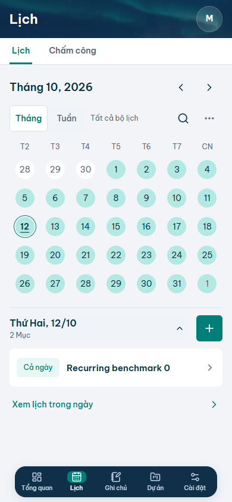
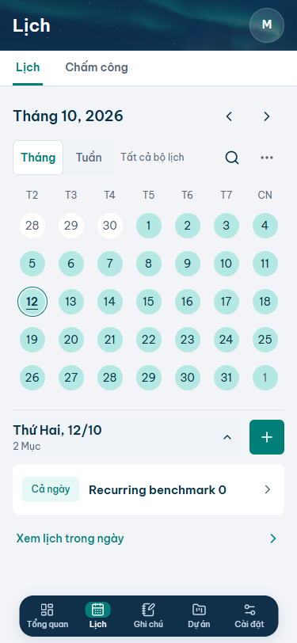

# Tối ưu hiệu năng mobile — 12/10/2026

Triển khai sau [audit](performance-audit.md) và người dùng cho phép code; người dùng yêu cầu push Git ngày 12/10/2026. Giữ thiết kế, dữ liệu và nghiệp vụ hiện tại; Vercel do người dùng deploy. Preview local chạy ở http://127.0.0.1:3100/calendar, mode IndexedDB; không thay `.env.local`.

## Đã sửa

1. Lịch mobile lập bảng occurrence theo ngày một lần cho vùng xem. Mỗi occurrence parse thời gian một lần; đóng/mở preview và bộ lọc dùng lại bảng. Giữ qua đêm, end exclusive, nhiều ngày, thứ tự và ngoại lệ chuyển buổi.
2. FullCalendar/plugins tải động khi xem desktop. Mobile không tải ba chunk desktop và không tính DTO/occurrence phục vụ desktop. Khi đổi viewport, ngày/chế độ đã chọn vẫn hoạt động; điều khiển desktop đợi lịch sẵn sàng.
3. Kiểm tra trùng dùng danh sách khoảng thời gian đã sắp xếp, prefix max end và tìm kiếm nhị phân, thay so sánh mọi cặp. Form không tính lại trùng khi chỉ sửa tiêu đề/mô tả/metadata; submit vẫn validate toàn bộ input và hỏi xác nhận trùng.
4. Vào Lịch thông thường chỉ subscribe events/settings. Projects/Notes tải khi query liên kết cần nguồn đó, khi mở bộ chọn hoặc khi chi tiết có liên kết. Dùng lại key/cache SWR theo UID và canonical sau commit, không thêm cache server/persist/CDN hoặc thay policy refresh.
5. Menu mobile phản hồi pending có accessible label ổn định. Prefetch các route chính khi browser rảnh, sau 1,2 giây và cách nhau 500 ms; không chạy chuỗi này khi Save-Data/2G hoặc trang ẩn. Touch pointer-down cũng báo intent. Giữ loading hiện có, không thêm loading bao vùng riêng hoặc trang chi tiết; HTTP 404 giữ nguyên.
6. AccountProvider chuẩn bị CSRF trong nền sau 1 giây, dùng chung cache/in-flight promise hiện hữu. Không chặn đọc dữ liệu; nếu chuẩn bị thất bại, mutation vẫn dùng luồng cấp token/retry CSRF trước ghi. Notes mobile không tạo plain-text preview đang ẩn bằng CSS.
7. API `/api/data` có `Server-Timing` cho auth, read/write và total, kể cả lỗi. Chỉ trả duration; không kèm UID/cookie/credentials/nội dung. Giữ no-store/private, kiểm tra thu hồi/vô hiệu hóa, UID, CSRF, transaction và version. Total tính trong handler, không bao gồm toàn bộ cold start/network phía ngoài handler.

## Kết quả đo trước/sau

Cùng script, Edge Chromium headless, context độc lập, viewport 390 × 844, fixture riêng trong IndexedDB. CPU mô phỏng chậm 4×; các lịch không lặp có thêm mạng 150 ms latency/down 200.000 byte/s. Chuỗi lặp đo CPU 4×, không thêm latency mạng. Các thao tác đóng/mở hoàn toàn ở client. Ba mẫu mỗi trường hợp, bảng lấy trung vị từ pointer-up tới nội dung và hai animation frame.

| Đóng/mở chi tiết ngày | Trước | Sau | Giảm thời gian |
| --- | ---: | ---: | ---: |
| 2 lịch không lặp | 64 ms | 56 ms | 13% |
| 30 lịch không lặp | 314 ms | 47 ms | 85% |
| 100 lịch không lặp | 906 ms | 37 ms | 96% |
| 2 chuỗi lặp hằng ngày, 64 occurrence trong vùng xem | 670 ms | 32 ms | 95% |

Trên máy không throttle, 30 lịch giảm 67→18 ms; 100 lịch giảm 176→25 ms. Thời gian bấm vào Lịch lần đầu trong chuỗi thao tác có mạng/CPU mô phỏng giảm 1.369→313 ms; ở bản mới route đã được prefetch trước khi bấm. Đây là cải thiện phần chờ sau thao tác, không phải benchmark tải khởi động toàn ứng dụng.

Quay lại phân hệ với dữ liệu trống: trước 49–110 ms, sau 72–123 ms trong phép đo mô phỏng; chưa có cải thiện rõ ở tình huống vốn đã nhanh này. Không dùng kết quả local để khẳng định độ trễ route/save/delete Firestore trên điện thoại thật đã được giải quyết hoàn toàn. Chưa có INP/RUM hoặc p95 production.

## Kiểm chứng

- Lint, TypeScript strict, format và production build local đạt; cloud build/API suite cũng đã được kiểm tra trong luồng Emulator.
- Local: 110 case đã xác nhận đạt, 36 skip theo cấu hình (domain chỉ chạy desktop, các luồng viewport riêng). Lần chạy toàn bộ bản cuối: 106 đạt, 4 lỗi ghi ảnh PNG Windows. Sau chuyển output ảnh sang `testInfo.outputPath` tách theo case, 7 case liên quan chạy lại đều đạt. Không sửa assertion để bỏ lỗi nghiệp vụ; các kiểm tra 404/runtime, drag/rollback, autosave/version/draft, Notes revisions/media, liên kết, điều hướng và đổi viewport đã đạt.
- Firebase Emulator: 20 case đã xác nhận đạt (19 ở lần toàn bộ, case màu mobile chạy lại đạt sau cập nhật locator theo badge/preview đã duyệt). Bao gồm lazy linked libraries/CSRF/Server-Timing, quyền hai tài khoản, revoked/disabled, cache/GET về muộn, logout tab khác, Notes revisions, transaction/version, CRUD và autosave offline/tuần tự.
- Performance E2E xác nhận mobile không yêu cầu ba chunk FullCalendar desktop; resize sang desktop mới tải chúng và giữ điều khiển/ngày. Có kiểm tra phản hồi điều hướng khi RSC bị chậm.
- Đã xem screenshot thực tế 390 × 844 và 375 × 812: typography, căn chỉnh, heatmap, selected/today, preview, thao tác và menu giữ thiết kế hiện hành; không tràn ngang/che nút. Screenshot dùng fixture kiểm thử, không phải dữ liệu người dùng.
- Ảnh E2E tự động ghi vào output riêng, tránh ghi đè bộ thiết kế và tranh chấp file Windows. Các ảnh thiết kế đã theo dõi trong Git được giữ nguyên.

## File code

| Nhóm | File |
| --- | --- |
| Lịch và kiểm tra trùng | `src/modules/calendar/recurrence.ts`, `components/mobile-calendar.tsx`, `components/calendar-screen.tsx`, `components/desktop-calendar.tsx`, `components/event-form.tsx`, `components/event-details.tsx` (components nằm dưới module Calendar) |
| Subscription dùng chung | `src/lib/repository-cache.tsx`, `src/modules/projects/use-projects.ts`, `src/modules/notes/hooks.ts` |
| Điều hướng và phản hồi | `src/components/app-shell.tsx`, `src/app/globals.css` |
| CSRF và số đo cloud | `src/modules/auth/account-context.tsx`, `src/app/api/data/route.ts` |
| Ghi chú mobile | `src/modules/notes/components/notes-screen.tsx` |
| Kiểm thử | `tests/e2e/performance.spec.ts`, `calendar-domain.spec.ts`, `firebase.spec.ts`; output ảnh ở `calendar-design.spec.ts`, `mobile-document-update.spec.ts`, `mobile-refinements.spec.ts`, `module-header-photos.spec.ts`, `overview-cover.spec.ts` |

README, architecture, source map, hướng dẫn modules/tests và ADR 006 đã được cập nhật. `.env.example` đang bị xóa từ trước lượt này; không sửa/khôi phục/stage thay đổi đó.

## Còn cần đo trên deployment

Sau khi bản mới được triển khai, dùng Network/Server-Timing trong phiên đã đăng nhập để so sánh auth, read/write, tổng request và tap→paint trên iPhone/Safari standalone, Wi-Fi/4G, lần đầu/quay lại và save/delete có/không nháp. Không bỏ kiểm tra quyền hoặc báo đã lưu trước commit để giảm thời gian hiển thị.

Chưa thay query toàn bộ danh sách, lịch sử 20 revisions Notes, hợp đồng DTO/schema, region Firestore/Vercel hoặc thêm optimistic mutation. Những thay đổi đó cần số đo production để chọn đúng phần tốn thời gian. Asset/màu/header/modal và autosave 700/800 ms được giữ.

## Screenshot kiểm tra

